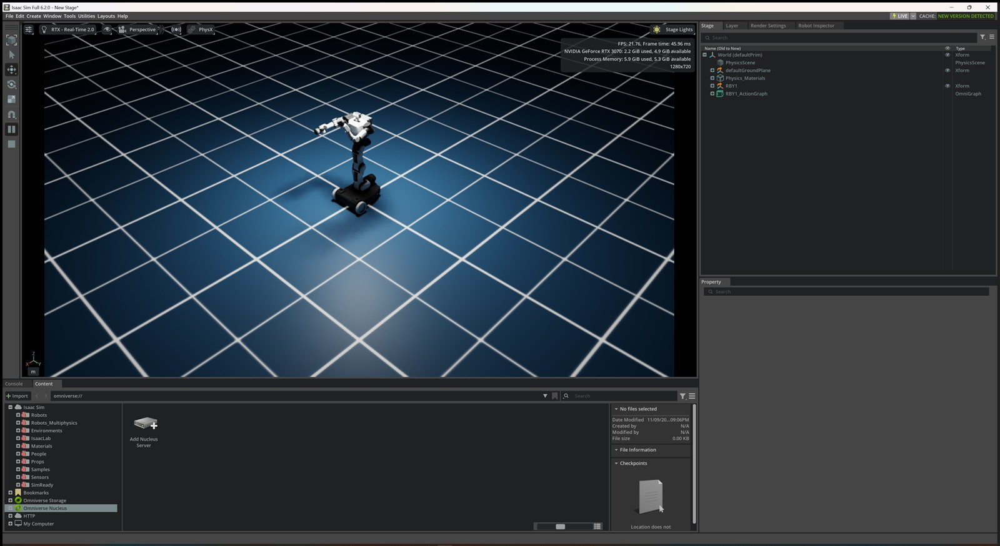
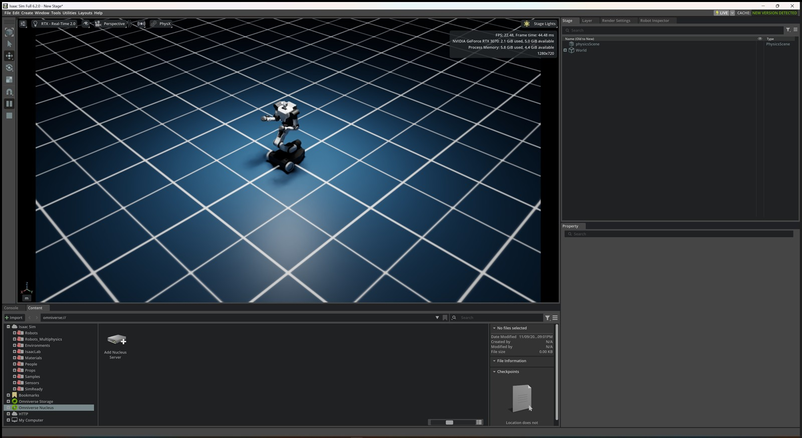
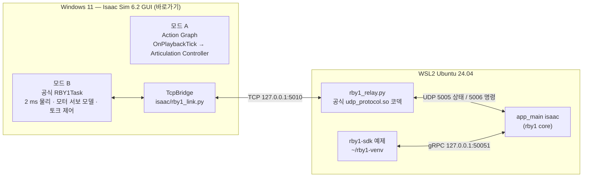

# RB-Y1 A × Isaac Sim 6.2 실습 가이드 (Windows 11)

바탕화면 바로가기 `Isaac Sim 6.2.0.lnk`(= `C:\isaacsim-6.2\isaac-sim.bat`)로 띄운 Isaac Sim에서 RB-Y1 Model A v1.2를 불러와 두 가지 방식으로 움직인다.

| 모드 | 무엇으로 움직이나 | 스크립트 | 상태 (2026-11-09) |
|---|---|---|---|
| **A. Action Graph** | Isaac Sim 기본 노드 `Articulation Controller` | `isaac/rby1_actiongraph.py` | headless·GUI 검증 완료 |
| **B. rby1 소프트웨어** | Rainbow 공식 rby1 core(`app_main`) + `rby1-sdk` 예제 | `isaac/rby1_sdk_mode.py` + `wsl/start_core.sh` | headless·GUI 검증 완료 |

| 모드 A — Action Graph로 팔 목표각 변경 | 모드 B — rby1-sdk `25_wiggle_motion.py` 준비 자세 |
|---|---|
|  |  |

## 1. 전체 구조



**왜 이 구조인가.** 공식 [rby1-sim-isaac](https://github.com/RainbowRobotics/rby1-sim-isaac)은 Linux Docker(`docker/run_sdk.sh`)만 지원한다. 이 PC에는 Docker가 없고, Isaac Sim은 WSL에서 렌더링하지 못한다. 그래서 다음처럼 나눴다.

- **Isaac Sim은 Windows 네이티브로 실행한다.** 바로가기로 띄운 GUI 그대로 쓴다.
- **rby1 core는 WSL에서 실행한다.** Linux 전용 바이너리다. 공식 Docker 이미지에서 core 파일만 추출했다(이미지 전체 10.5 GB 중 약 80 MB).
- **공식 UDP 코덱(`udp_protocol.*.so`)도 Linux 전용이라 WSL 릴레이에서 그대로 쓴다.** Windows와 WSL 사이에는 그 함수의 입력·출력만 TCP로 오간다. WSL2는 Windows의 `localhost` TCP를 자동으로 WSL에 전달하므로 방화벽·IP 설정이 필요 없다.

## 2. 이 PC에서 확인한 환경

| 항목 | 값 |
|---|---|
| GPU | RTX 3070 8 GB, 드라이버 610.60. 이 구성에서 VRAM 약 2.2 GB 사용 |
| Isaac Sim | 6.2.0 (`C:\isaacsim-6.2`), 바로가기 인자 `--/app/extensions/fsWatcherEnabled=false` |
| WSL | Ubuntu-24.04, Python 3.12.3, systemd 사용 |
| Docker | 없음 (Windows·WSL 모두) |
| WSL DNS | **고장**. 기본 DNS 10.255.255.254 응답 없음, 1.1.1.1은 정상 → 10장 |

## 3. 폴더 구조

```text
E:\Github\IsaacSim-rby1\
├─ isaac\                    Isaac Sim(Windows)에서 실행
│  ├─ rby1_actiongraph.py    모드 A: 로봇 로드 + Action Graph 생성
│  ├─ rby1_sdk_mode.py       모드 B: 공식 RBY1Task + TcpBridge
│  └─ rby1_link.py           TCP 프레임 코덱 + TcpBridge (WSL 릴레이와 공용)
├─ wsl\                      WSL에서 실행
│  ├─ start_core.sh          릴레이 + app_main isaac 동시 실행
│  └─ rby1_relay.py          TCP ↔ UDP 중계
├─ tools\
│  ├─ fetch_rby1_core.py     공식 Docker 이미지에서 rby1 core만 추출 (Docker 불필요)
│  ├─ check_link.py          Windows↔WSL 왕복 지연 점검
│  └─ verify_headless.py     두 모드 자동 검증 (headless)
├─ docs\img\                 GUI 확인 화면
├─ rby1-sim-isaac\           공식 시뮬레이터 저장소 clone (USD 에셋, RBY1Task)   ┐
├─ rby1-sdk\                 공식 SDK 저장소 clone (예제, URDF)                  │ git 제외
├─ rby1-core\                이미지에서 추출한 app_main, udp_protocol.so         │
└─ wheels\                   WSL 오프라인 설치용 wheel                           ┘
```

## 4. 환경 셋팅 (완료된 항목의 재현 절차)

이미 이 PC에는 다 되어 있다. 다른 PC에서 다시 만들 때만 따라 한다.

```powershell
cd E:\Github\IsaacSim-rby1
git clone --depth 1 https://github.com/RainbowRobotics/rby1-sim-isaac.git
git clone --depth 1 https://github.com/RainbowRobotics/rby1-sdk.git

# rby1 core 추출: 이미지 태그 0.11.0-a_v1.2-isaac6.2.0 (Model A v1.2, Isaac Sim 6.2.0)의 작은 레이어만 받음
C:\isaacsim-6.2\kit\python\python.exe -I tools\fetch_rby1_core.py --out E:\Github\IsaacSim-rby1\rby1-core

# WSL용 wheel (WSL DNS가 고장이라 Windows에서 받음)
C:\isaacsim-6.2\kit\python\python.exe -m pip download "rby1-sdk==0.10.1" "numpy==2.3.1" --only-binary=:all: --platform manylinux_2_35_x86_64 --platform manylinux_2_28_x86_64 --python-version 3.12 --implementation cp -d wheels
```

```bash
# WSL
python3 -m venv ~/rby1-venv
~/rby1-venv/bin/pip install --no-index --find-links /mnt/e/Github/IsaacSim-rby1/wheels rby1-sdk==0.10.1
```

- `rby1-sdk 0.10.1`은 `numpy>=2.0.1`을 요구한다. Ubuntu 기본 numpy는 1.26이라 venv를 따로 만들었다.
- 릴레이도 이 venv의 Python(numpy 2.3.1)으로 돈다. 공식 `udp_protocol.so`가 이 환경에서 정상 import되는 것을 확인했다.

## 5. 모드 A — Action Graph로 양팔 움직이기

1. 바탕화면 **Isaac Sim 6.2.0** 바로가기로 실행한다. 이 PC에서 준비 완료까지 약 50초 걸린다.
2. **Window > Script Editor** → 상단 **File > Open** → `E:\Github\IsaacSim-rby1\isaac\rby1_actiongraph.py` → **Run** (Ctrl+Enter).
   - ⚠️ 현재 Stage를 새 Stage로 바꾼다. 저장 안 한 작업이 있으면 먼저 저장한다.
   - 콘솔에 `[RBY1 ActionGraph] loaded ... Press Play.`가 나오면 성공이다.
3. 왼쪽 툴바의 **Play(▶)**를 누른다. 양팔이 팔꿈치 90° 준비 자세로 이동한다.
4. **Window > Graph Editors > Action Graph** → 왼쪽 목록에서 `/World/RBY1_ActionGraph`를 연다.

```text
On Playback Tick ─┬─▶ Articulation Controller   robotPath=/World/RBY1, jointNames=양팔 14개, positionCommand=목표각[rad]
                  └─▶ Articulation State        같은 14개 관절의 현재 위치·속도·토크 출력
```

5. **Articulation Controller** 노드를 클릭 → Property 패널 `inputs:positionCommand` 값을 바꾼다. Play 중에 바꾸면 바로 따라 움직인다.
   - 순서: `right_arm_0..6`, `left_arm_0..6`. 단위는 **라디안**이다 (1 rad ≈ 57.3°).
   - 예시: 2번째 값(`right_arm_1`)을 `-0.17` → `-1.0`으로 바꾸면 오른팔이 옆으로 벌어진다. 8번째 값(`left_arm_0`)을 `-1.2`로 바꾸면 왼팔이 앞으로 들린다. 위 왼쪽 화면이 이 상태다.
6. **Articulation State** 노드를 클릭하면 `outputs:jointPositions`에서 실제 각도를 볼 수 있다. 목표값과 비교한다.

스크립트가 장면에 넣는 설정은 다음과 같다. 공식 RBY1Task와 같은 값이다.

- 바닥: Isaac 기본 Grid 환경
- 물리: 500 Hz
- articulation: 자기충돌 OFF, 솔버 반복 4/1

**자기충돌을 켜 두면 로봇이 뒤로 넘어진다.** 실측으로 확인했고, 공식 코드 주석도 USD 충돌 형상 때문에 관절이 불안정해진다고 밝힌다.

### 관절 한계 (USD 실측, 단위 °)

| 관절 | 한계 | 관절 | 한계 |
|---|---|---|---|
| right_arm_0 / left_arm_0 | −180 ~ 180 | right_arm_4 / left_arm_4 | −180 ~ 180 |
| **right_arm_1** | **−180 ~ 0** | right_arm_5 / left_arm_5 | −90 ~ 110 |
| **left_arm_1** | **0 ~ 180** | right_arm_6 / left_arm_6 | −155 ~ 155 |
| right_arm_2 / left_arm_2 | −180 ~ 180 | torso_0 / 1 / 2 | −15~15 / −30~90 / −150~90 |
| right_arm_3 / left_arm_3 | −150 ~ 0 | head_0 / head_1 | −90 ~ 90 |

- USD의 모든 관절 드라이브는 Stiffness 100, Damping 10이다. 단위는 °당 값이다.
- 그래프에 넣지 않은 몸통·머리·바퀴는 목표 0°를 유지한다.

### 해볼 만한 변형

- `jointNames`에 `torso_1`, `head_0`을 추가하고 `positionCommand`에 값 2개를 덧붙인다. 개수가 같아야 한다.
- ROS 2로 확장한다. `ROS2 Subscribe Joint State` 출력을 Controller 입력에 연결한다. 이 설치본의 예시는 `C:\isaacsim-6.2\standalone_examples\api\isaacsim.ros2.bridge\moveit.py`에 있다.

## 6. 모드 B — rby1 core + rby1-sdk로 움직이기

검증한 실행 순서는 **core → Isaac Sim 스크립트 → SDK 예제**다.

1. **WSL 터미널 1** — core와 릴레이를 켜 둔다. 끌 때는 Ctrl+C를 누른다.

   ```bash
   bash /mnt/e/Github/IsaacSim-rby1/wsl/start_core.sh             # core 상태 창(WSLg)까지 표시
   HEADLESS=1 bash /mnt/e/Github/IsaacSim-rby1/wsl/start_core.sh  # 창 없이 (검증에 쓴 방식)
   ```

   - `Server listening on 0.0.0.0:50051`이 보이면 준비된 것이다.
   - Ctrl+C로 끌 때 `Segmentation fault`(종료 코드 139)가 찍힌다. 종료 단계에서 공식 바이너리가 내는 것이다. 동작 중에는 문제가 없었다.
2. **Isaac Sim**(바로가기) → Script Editor → `isaac\rby1_sdk_mode.py` 열기 → Run.
   - 공식 `RBY1Task`가 로봇을 띄우고 바로 Play한다. 물리 2 ms(500 Hz)이고, 관절은 공식 모터 서보 모델의 토크로 구동된다.
   - 콘솔에 `[TcpBridge] connected to relay`가 뜨면 연결된 것이다.
   - core가 아직 명령을 보내지 않으면 현재 자세(0°)를 PD로 유지한다.
3. **WSL 터미널 2** — 공식 SDK 예제를 실행한다. 예제끼리 `00_helper.py`를 import하므로 예제 폴더에서 실행한다.

   ```bash
   source ~/rby1-venv/bin/activate
   cd /mnt/e/Github/IsaacSim-rby1/rby1-sdk/examples/python
   python 03_robot_state.py     --address 127.0.0.1:50051 --model a   # 상태 읽기 (검증)
   python 25_wiggle_motion.py   --address 127.0.0.1:50051 --model a   # 준비 자세 → 몸통 원운동, Ctrl+C로 정지 (검증)
   python 23_zero_pose.py       --address 127.0.0.1:50051 --model a   # 영점 자세 (미실행)
   python 24_demo_motion.py     --address 127.0.0.1:50051 --model a   # 관절·직교·임피던스 데모 (미실행)
   ```

   실기와 같은 코드다. `--address`만 실기 주소(예: `192.168.30.1:50051`)로 바꾸면 그대로 쓴다.

### 포트

| 포트 | 위치 | 방향 | 내용 |
|---|---|---|---|
| TCP 5010 | WSL (Windows localhost로 전달) | Isaac Sim ↔ 릴레이 | 이 저장소에서 정한 포트 |
| UDP 5005 | WSL | 릴레이 → app_main | RobotState |
| UDP 5006 | WSL | app_main → 릴레이 | RobotCommand |
| TCP 50051 | WSL | rby1-sdk ↔ app_main | gRPC |

### core 없이 공식 내장 궤적만 보기

`rby1_sdk_mode.py` 맨 위의 `USE_CORE = True`를 `False`로 바꾸고 다시 Run한다. RBY1Task의 내장 테스트 궤적은 팔·몸통을 0°로 유지하고 바퀴에 속도 명령을 줘서 천천히 주행한다.

### 공식 Docker 실행과 다른 점

| 항목 | 공식 `run_sdk.sh` | 이 저장소 |
|---|---|---|
| Isaac Sim | Docker 안 Linux | Windows 바로가기 GUI |
| 시뮬 루프 | `simulation.py`의 `while` 루프 | GUI 물리 콜백 (`world.step_async` + `post_physics_step`) |
| 상태·명령 전송 | UDP 직접 | TCP → WSL 릴레이 → UDP (왕복 평균 0.38 ms 추가) |
| 명령 대기 | 무한 대기 | 스텝당 최대 0.2 s (GUI 멈춤 방지) |
| 미포함 | — | 그리퍼, 외력 UI, Backspace 리셋, gRPC 리셋, 실시간 페이싱(`RBY1_REALTIME`) |

## 7. 점검 도구

```powershell
# Windows↔WSL 링크 점검 (start_core.sh가 꺼진 상태에서)
wsl -d Ubuntu-24.04 -- python3 /mnt/e/Github/IsaacSim-rby1/tools/check_link.py --serve   # 창 1
C:\isaacsim-6.2\python.bat E:\Github\IsaacSim-rby1\tools\check_link.py                    # 창 2

# 두 모드 자동 검증 (Isaac Sim GUI를 끈 상태에서)
C:\isaacsim-6.2\python.bat E:\Github\IsaacSim-rby1\tools\verify_headless.py actiongraph
C:\isaacsim-6.2\python.bat E:\Github\IsaacSim-rby1\tools\verify_headless.py builtin
C:\isaacsim-6.2\python.bat E:\Github\IsaacSim-rby1\tools\verify_headless.py core 120     # start_core.sh 실행 중, 120초 동안 2초마다 관절각 출력
```

## 8. 검증 기록 (2026-11-09)

| 항목 | 결과 |
|---|---|
| USD 구조 | articulation root `/RBY1_A_v1_2`, revolute 24 + fixed 1, 드라이브 K100/D10 |
| `rby1_link` 코덱 자체 점검 | 통과 (WSL numpy 1.26, Isaac Sim numpy 2.x 양쪽) |
| Windows→WSL TCP 왕복 1000회 | 평균 **0.383 ms**, p99 0.664 ms, 최대 1.399 ms |
| 공식 `udp_protocol.so` | venv(numpy 2.3.1)에서 import 성공. 상태 패킷 808 B로 공개 헤더 형식과 일치. 명령의 kp/kd는 생략 시 `None` |
| app_main 기동 | 모델 rby1a v1.2, core 0.11.0, SDK 0.10.1, gRPC `0.0.0.0:50051`, 제어 루프 평균 2.000 ms |
| 모드 A headless | **PASS**. 양팔 14관절 목표 대비 최대 오차 **0.36°**, 베이스 직립 1.000 |
| 모드 A GUI | 로봇 직립, 실행 중 `positionCommand` 변경에 팔이 따라감 (위 왼쪽 화면) |
| 모드 B 내장 궤적 headless | **PASS**. 약 6,200 스텝, 베이스 직립 1.000, rtf 약 1.6 (headless, 페이싱 없음) |
| 모드 B core headless (120 s) | **PASS**. 63,904 스텝 동안 명령 63,903개 수신, 명령 흐름 중 rtf ≈ 1.0. 직립은 GUI 화면으로만 확인했다(직립 검사 추가 전 실행) |
| SDK `03_robot_state.py` | core를 통해 시뮬 관절 위치·토크 읽음 |
| SDK `25_wiggle_motion.py` | 목표 torso [0, 45, −90]°, 팔 [0, ∓5, 0, −120]°. 시뮬 결과 torso_1 39~49°(원운동 진폭 ±7.4°), torso_2 −89~−95°, arm_1 ∓5.0°, arm_3 −120.4° |
| 모드 B GUI | 같은 예제로 준비 자세 확인 (위 오른쪽 화면), GUI rtf 0.84~0.91, FPS 약 22 |

## 9. 트러블슈팅

| 증상 | 확인 |
|---|---|
| 로봇이 넘어짐 (모드 A) | 스크립트를 수정해 자기충돌을 켰는지 확인한다. 자기충돌 OFF가 필수다 |
| `positionCommand`를 바꿔도 안 움직임 | Play 상태인지, `jointNames`와 `positionCommand` 개수가 같은지, 값이 라디안인지 |
| Script Editor 실행 후 로봇이 안 보임 | 콘솔의 USD 경로, `rby1-sim-isaac\assets\model_v_1_2_a.usd` 존재 여부 (약 13.9 MB) |
| 바닥이 안 보임 | Isaac 기본 Grid 환경은 Isaac 에셋 서버에서 받는다. 인터넷 연결을 확인한다 |
| 모드 B에서 `connected to relay`가 안 뜸 | WSL에서 `start_core.sh`가 도는지, `ss -ltn \| grep 5010`. 리스너가 뜬 뒤 Windows 전달까지 수 초 걸린다 |
| `[relay] idle 5 s` 반복 | Isaac Sim이 Play 중인지, Stop 후 Play했다면 스크립트를 다시 Run |
| `NameError: LOADER_DIR` (cv2 `config.py`) | Isaac Sim 번들 cv2와 공식 `config` 모듈의 이름 충돌이다. `rby1_sdk_mode.py`가 공식 `config.py`를 경로로 직접 로드해 해결한다. 공식 `src`를 다른 방식으로 import할 때 주의한다 |
| 모드 B가 실시간보다 약간 느림 (GUI rtf 0.85 전후) | 정상 범위다. 매 2 ms 스텝마다 core 응답을 기다리고 렌더링도 한다 |
| 스크립트를 다시 Run하면 이전 장면이 사라짐 | 의도된 동작. 두 스크립트 모두 새 Stage를 만든다 |

## 10. WSL DNS 고장 (이 PC에서 확인)

- WSL 기본 DNS 프록시 `10.255.255.254`가 응답하지 않는다. 그래서 WSL 안에서 `pip install`, `git clone`이 실패한다. 외부 IP 연결과 `1.1.1.1` 질의는 정상이다.
- 지금은 Windows에서 내려받아 WSL에 오프라인 설치하는 방식으로 우회했다.
- 근본 해결은 아래와 같다. WSL 전체 설정이 바뀌므로 직접 판단해서 적용한다.

```ini
; %USERPROFILE%\.wslconfig
[wsl2]
dnsTunneling=false
```

적용: PowerShell에서 `wsl --shutdown` 후 WSL을 다시 연다.

## 11. 남은 일과 위험

- GUI 확인은 `isaac-sim.bat --exec <스크립트>`로 바로가기와 같은 앱(`isaacsim.exp.full.kit`)을 띄워 했다. Script Editor 메뉴, Action Graph 편집기, Property 패널은 손으로 조작해 보지 않았다. 대신 같은 속성(`inputs:positionCommand`)을 코드로 바꿔 동작을 확인했다.
- 실행 순서는 core를 먼저 켜는 순서만 검증했다. Isaac Sim을 먼저 켜도 `TcpBridge`가 1초마다 재접속하지만 실측은 하지 않았다.
- SDK 예제는 `03`, `25`만 실행했다. `23`, `24` 등은 미실행이다.
- 추출한 core는 공식 공개 이미지의 파일이다. 개인 실습에만 쓰고 재배포하지 않는다.
- RTX 3070 8 GB에서 이 구성은 VRAM 약 2.2 GB를 쓴다. 카메라·센서를 많이 붙이면 여유가 줄어든다.

## 12. 근거

- [rby1-sim-isaac README](https://github.com/RainbowRobotics/rby1-sim-isaac) — 이미지 태그, UDP 포트, 서보 모델
- [rby1-sdk](https://github.com/RainbowRobotics/rby1-sdk) — `include/rby1-sdk/net/real_time_control_protocol.h`, Python 예제
- [Docker Hub rby1-sim-isaac](https://hub.docker.com/r/rainbowroboticsofficial/rby1-sim-isaac)
- Isaac Sim 6.2 설치본: `standalone_examples/api/isaacsim.ros2.bridge/moveit.py`, `exts/isaacsim.core.nodes/.../OgnIsaacArticulationController.ogn`, `extsDeprecated/isaacsim.core.api/.../world.py`
- Notion: [RB-Y1 공식 3D 모델 확보·Isaac Sim 6.2.0 불러오기](https://app.notion.com/p/40f3d76f887481de8a81ec25f01eed34), [LeRobot × Isaac Sim 실습 가이드 — RB-Y1a](https://app.notion.com/p/4123d76f88748196b551d7523ff699d2)
